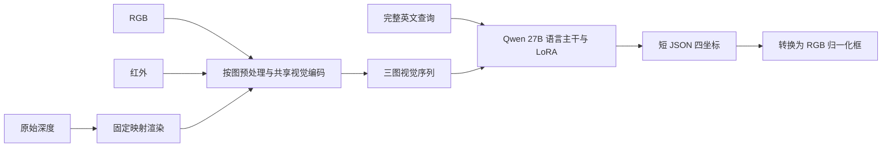

# 半决赛研究：让模型区分目标，并直接优化过线题数

研究时间：2026-10-22—23。已重新通读本地赛题材料，结合当前27B代码、历史实验、论文全文与重要开源实现形成以下方案。用户已确认进入半决赛，复赛复现材料不再补改。本轮完成研究与既有结果的CPU分析，没有启动新模型推理、GPU训练或取得新的比赛分数。

**我的推荐：保留27B原生三图直接框作为骨干；先构造同图竞争实例的真实监督，再加入“候选是否满足该查询”的判别辅助任务。** 同时做两个便宜的筛选：Qwen3.8独立基座、RGB与辅助模态的非对称分辨率。只有新的逐题证据支持，才进入阈值强化学习、两模型选择或新的融合层。成对数据本身不是新损失；判别辅助目标才是第一项实质性的训练机制改动。

## 1. 从题目和计分公式倒推

本地权威材料为工作区`contest/基于大模型的多模态视觉理解与推理.pdf`及同目录官方材料；[官方赛题页](https://www.aicomp.cn/tracks/3688.html)已再次核对。

\[
\mathrm{ACC@0.5}=\frac1N\sum_i\mathbb{1}\{\mathrm{IoU}(\hat b_i,b_i)\ge0.5\}.
\]

- 最终交的是**RGB坐标系、0–1归一化xyxy**，不是红外框、三维框或模型内部0–1000整数框。阈值是`>=0.5`，不先四舍五入IoU。
- 每条Query只对应一个目标；**多个Query可以指向同一目标**。题目没有给“查询与对象一一匹配”的跨查询约束。
- 每题等权。一个框IoU从0.8涨到0.9没有新增分；0.49跨到0.51有一题收益，0.55退到0.49也损失一题。不能只报平均IoU或只统计修好的错题。
- 红外为三通道灰度；原始深度为uint16毫米，过小值/0无效，越小越近。渲染图不等于原始测量；本项目当前渲染约定为近亮、远暗、无效黑。
- 公开外部训练数据可以使用并说明来源；测试图像不能用于训练，不能人工补标或修正测试预测，不能用商业闭源API生成测试答案。规则允许的官方反馈可用于模型选择，但不能把反馈当逐题标签。研究用途许可证还需与实际参赛用途相符。

因此目标应是增加“正确目标且框过线”的查询数。即使继续增加算力，也应问这些计算增加了可见信息、目标辨别能力还是过线决策质量，而不是默认长推理或更多模块会加分。

## 2. 当前架构真正提供了什么

最高已记录路径为Qwen3.6-27B、Arm 2 ck500、语言侧LoRA、三图2倍插值、vLLM，官方记录0.8012。视觉塔和连接层未训练，三路经共享视觉编码，在语言主干里交互。它已经具有多图注意力，不能把“再加一次cross-attention（交叉注意力）”本身当成缺失能力。真正可能缺少的是：传感器域适配、查询与竞争实例的区分监督，以及与计分阈值一致的优化目标。

Arm 2训练的部分原始深度曾被错误转为RGB；后来的深度修复、排除重叠和视觉侧训练属于不同训练臂，尚未形成超过0.8012的记录。这既不证明深度无用，也不证明修好深度必涨。最高分路径存在历史同帧重叠记录，新半决赛训练必须按允许的数据边界重新组织。旧8B候选/Agent实验不能代替当前27B错误分析。详见[接手审计](../2026-10-22-takeover/README.md)。

### 本轮对既有文件的新增观察

分析脚本为[analyze_existing_outputs.py](analyze_existing_outputs.py)，完整聚合结果为[existing-output-analysis.json](existing-output-analysis.json)。不包含官方真值，不改写提交。

| 只读观察 | 结果 | 能支持什么、不能支持什么 |
|---|---:|---|
| 5690条历史官方输入按三张路径分组 | 1295组；5626条属于多Query组 | 可研究图组共享证据；不证明跨Query目标互斥，也不代表半决赛分布 |
| Arm 2原生与2倍输出的框间IoU<0.5 | 531题，其中301题零重叠 | 分辨率会改变一部分目标决策；没有GT不能判哪一方正确 |
| Arm 2与Arm 4，两者均2倍 | 313题框间IoU<0.5 | 有预测分歧；不等于有313题可救 |
| Arm 2与Arm 5，两者均2倍 | 263题框间IoU<0.5 | 同上，不足以证明集成收益 |
| City412真框四舍五入至0–1000后再还原 | 412题全部仍过线；最低IoU约0.8533 | 该集合的坐标网格精度本身不是主要瓶颈；不证明模型会生成正确数字 |

一个合成例子也说明：两个相距较远的候选框逐坐标平均，所得框可以与两者都零重叠。**跨实例分歧不做框平均。** 当前27B的完整逐题本地预测尚未找齐，不能沿用旧8B“47题候选可救空间”估算收益。

## 3. 第一条主线：直接定位加实例判别辅助目标

### 3.1 数据底座：查询变化时，目标必须随之变化

优先复用[RGBT-GroundBench](https://github.com/crazyxiaoxi/RGBT-GroundBench)的真实RGB/红外/表达/框，以及仓库已有RoboRefIt转换链，抽取同图同类、外观相似、框不同的目标对。例如同一场景两辆相似车辆，各有真实描述和RGB框。左右、序数、遮挡、动作、参照物关系分开标记；“近相机”和“靠近另一对象”也分开。

优先使用已有真实表达。不能机械替换left/right就认为得到了合法反事实，也不能把遮挡对象的全部框排序当作“第二个”而忽略Query限定的对象集合。新增图组按场景/序列隔离，保留普通样本，防止只会少数关系模板。

**单纯把两条独立SFT样本排在一起，没有新增对比损失。** 相同行、曝光和独立交叉熵下，它主要改变采样/批次相关性；不能称为结构突破，也不应把排列顺序作为主实验。此步骤的价值是更好的监督覆盖。

### 3.2 最小实质改动：同图候选判别辅助任务

继续复用同一个27B和语言LoRA，训练两种输入输出：

| 任务 | 输入 | 输出/监督 |
|---|---|---|
| 直接定位 | 三图＋完整Query | 当前短JSON框，保持主任务 |
| 候选判别 | 同三图＋同Query＋RGB全图坐标候选A/B | `A / B / both / neither`，分别由候选IoU是否≥0.5生成标签 |

候选优先使用合法训练集上的模型错误和同类竞争对象，补充尺度错误及双失败框；顺序随机，加入both/neither避免被迫接受一个错误答案。一个对象框对Query A为正、对Query B为负，有助于阻断“只看框大小或显眼程度”的捷径。不能把未穷尽标注的其他区域直接视为不存在目标；这里的负标签仅依据该Query的唯一真框生成。

\[
L=\overline{L}_{\mathrm{box\,CE}}+\lambda\overline{L}_{\mathrm{choice\,CE}}.
\]

两项先分别按监督输出token取均值，再加权。它是明确的判别辅助目标，不是新的视觉骨干，也不是普通困难样本重采样。最小版仍用ms-swift的多任务SFT数据；实际混合比例与loss归一化必须在当前版本核对，不能把“标签样本占比”等同于有效损失权重。单标签分数也不自动成为校准过的正确概率。

**第一轮推理仍一次直接框。** 辅助任务是否使共享表征更会区分实例，必须由该直接框的总ACC证明；辅助题答得好而定位不涨，就是没有迁移。此时不额外串联选择器，不把候选池作为所有查询的上限。

最重要的两个对照：

1. 同图像/Query池、同总训练视觉token预算：纯直接框SFT，与把部分预算分配给判别任务比较；另列各任务实际曝光，承认这是预算分配比较。
2. 同辅助任务预算：同类困难负例，与随机负例比较。前者才检验实例竞争监督，而非任意多任务带来的正则效果。

同时报告总ACC、同图目标对同时答对率、错误实例→正确实例数、原本正确被破坏数。只有前两项增长而后者受控，才值得扩大。

## 4. 两个优先级很高、成本较低的筛选

**独立检查Qwen3.8-27B。** [官方模型卡](https://huggingface.co/Qwen/Qwen3.8-27B)确认开放权重、图像输入与Apache-2.0。下载的3.6/3.8模型及图像配置除版本元数据外一致，降低了适配成本；不代表旧LoRA能直接迁移，聊天模板也要核对。先以相同提示、视觉预算比较3.6和3.8零样本，再与微调Arm 2比较实用价值。3.8零样本未超过微调Arm 2，不足以否定其微调潜力；有互补时再做同数据、同预算的短SFT。

**把视觉预算从“三图统一放大”改为可比较的非对称预算。** 先做RGB 2×、IR/D 1×，检查省下的计算是否伤精度；再把节省预算转给RGB，检查高分辨率RGB是否更有价值。这是两个不同实验。实际视觉token数读取`image_grid_thw`，不只记像素上限。

当前配置patch=16、merge=2，尺寸因子为32；三图2×的视觉token粗量级约2.43万，实际受取整影响。插值不会创造原始信息，可能改变的是目标占据的token数和编码尺度。原图已经低于上限时，仅增大`max_pixels`是空操作，无需消耗完整评估预算去证明。固定重叠图块排在上述实验之后，全图必须保留；围绕错误初猜裁剪容易反复放大错误对象。

## 5. 后续分支必须由错误证据触发

| 分支 | 进入条件 | 最小实现 | 不继续投入的信号 |
|---|---|---|---|
| 阈值GRPO（组相对策略优化） | 当前27B仍有身份正确的几何错误；采样得到有差异的框/奖励 | 现有ms-swift接自定义短框奖励，小规模LoRA | 只涨平均IoU；过线净收益不涨；绝大多数采样同一错误实例且无有效信号 |
| Rex-Omni独立定位/两模型选择 | 需要不同来源的可见性或定位能力 | 先完整Query独立单图预测，再单独比较短语化；只在有独有正确框时训练选择 | 新模型几乎不补主线错题；选择器持续毁掉更多正确框 |
| 原始深度数值证据 | 明确涉及近相机关系，且毫米值有效 | 复用现有ROI深度统计，用训练时有标注/推理时可计算的区域提证据 | 去掉深度收益不变；无效值或前景/背景混合主导结果 |
| 模态专属适配或可靠性门 | 辅助模态有可靠证据，但当前主干稳定读不出 | RGB锚定的小残差，明确基线与关闭门行为 | 仅训练源上涨；坏模态组及全分母净退化；部署成本吞掉可用实验预算 |

### 阈值奖励如何与分数一致

可试候选公式：

\[
r(\hat b,g)=\mathbb{1}\{u\ge0.5\}+\lambda\min(u,0.5),\qquad u=\mathrm{IoU}(\hat b,g).
\]

它使过线框获得主要奖励，小连续项给未过线但存在几何改善的采样提供排序信号；无效输出单独低奖。公式和λ是待实验设计，不是已证最优。纯二值奖励在同组全失败/全成功时没有组内差异，但不能据此说有连续项时也完全不可学。反过来，一组全部选错对象且IoU为0，几何奖励不能凭空给出语义方向。先记录组内IoU/奖励方差、有效组比例及GPU成本，再决定是否扩张，不先跑一轮昂贵27B大规模RL。

复用[ms-swift官方奖励扩展](https://github.com/modelscope/ms-swift/blob/d5253cbc5fe3258f143d1826d4078471fa0fc5dc/docs/source_en/Instruction/GRPO/DeveloperGuide/reward_function.md)，不移植旧单图Qwen2.5训练器。短框输出继续保留；长思维链、DPO（直接偏好优化）、连续定位头都需要额外证据才进入。实现接线见[swift-integration.md](swift-integration.md)。

## 6. 两个值得保留的逆向想法

**先定位，再让同图其他Query提供软证据。** 历史输入大多数Query共享图组，可以先独立输出，再共享图像编码或对象属性证据，检查明确互相矛盾的关系。允许多个Query命中同一对象，禁止直接做一一匹配。也不先把所有目标压进一张可能漏检的对象表。实现时区分单纯缓存节省计算，与跨Query推理的准确率增益；不得利用测试标签训练或人为调整答案。

**选择最可能过线的原框，而非平均坐标。** 对ACC而言，理想决策为
\[
\hat b^*=\arg\max_b\Pr(\mathrm{IoU}(b,g)\ge0.5\mid I,q).
\]
它一般不等于坐标均值，也不等于最高平均IoU的框。若两个模型在不同实例间分歧，需要学习查询与实例的判别；如果是同实例的小幅边界分歧，才考虑受控几何组合。模型自报confidence（置信度）或多数模型同意，均不自动等于此概率。候选判别辅助任务可为后续打分积累基础，但推理选择是否可靠仍要独立证明。

## 7. 论文到源码：哪些能借，哪些不能照搬

| 工作 | 关键核对 | 本项目取舍 |
|---|---|---|
| RGBT-GroundBench/VGNet | 与本赛二维表达定位较接近；独立模态LoRA、文字查询视觉、可靠性融合；个别模型加IR反而下降；源码默认融合与论文公式不完全一致 | 优先复用数据与模态贡献分析；网络非Qwen插件 |
| Rex-Omni | 直接坐标生成、有vLLM路径；公开F1式奖励对重复正确框仍可能给满分；训练`/1000`与解析`/999`不同 | 独立补漏备选；不照搬奖励；许可证为非商业研究条件 |
| VLM-R1 | IoU+格式的GRPO，源码主要单图Qwen2/2.5；有像素面积`+1`约定 | 取奖励/采样机制，用当前栈实现归一化IoU |
| MedGround-R1 | 论文描述局部ROI语义奖励；公开代码实际整图、二值化且默认未启用；`solutions/solution`接口不一致，阈值为`>0.5` | 不将公开脚本当成论文复现；只保留可检验假设 |
| Visual-RFT | 部分定位结果为mIoU，入口脚本还有文件名不一致 | 取机制，不拿外部指标预报本赛收益 |
| RDTTrack/RGBDT500 | 已给模板框的视频追踪，无指代表达；深度预处理丢绝对毫米；所谓正交块不等于严格投影 | 取三模态数据/轻量提示思想，不移植追踪器 |
| RGBX-R1 | 已给模板目标、交替RGB/X视频框序列；未定位到官方成品代码/数据；深度明暗提示与本项目相反 | 不能因名字含Grounding就当作本赛即插即用方案 |

详读材料、固定源码版本、具体函数与许可证说明分别在[指标与训练研究](metric-learning.md)、[感知与分辨率研究](perception.md)、[多模态研究](multimodal.md)、[路线审查](route-review.md)。这些是外部方法的证据与本项目推断，均不是AIC新实验结果。

## 8. 下一轮实验按这个顺序执行

1. **补当前模型的错误证据。** 在未参与旧选模的合法外部图组留出小集，获取当前27B逐题预测。City412继续作历史诊断，重新随机分割City不能恢复独立性。对象错选与框边界错误需要结合合法标注图像判断，不能只用IoU区间替代身份标签。
2. **冻结权重做基座和视觉预算筛选。** 3.6/3.8零样本、现有Arm 2、非对称分辨率分开比较。若新基座有价值，再用相同新训练数据短SFT；不把基座、数据、奖励三项一次换完。
3. **第一轮训练比较直接框与判别辅助目标。** 用相同图像/Query池、配平视觉token预算；困难负例与随机负例构成第二对照。先保住直接框的全分母净收益，再考虑将判别任务用于推理。
4. **按失败机制选一个后续分支。** 几何残留进入短框GRPO；独有候选覆盖进入两模型选择；可信近远证据进入数值深度。不要同时启动三条大训练。
5. **只把稳定候选送入规则允许的官方比较。** 报ACC、净翻转、图组/序列配对区间与计算成本；小样本区间宽不等于无效，可再独立确认一次。没有主指标增益但机制指标改善时，先找迁移失败原因，不能无限堆模块。

最终争分允许更多计算；机制比较需要配平预算，两种结论分开记录。以历史5690题为例，提升1个百分点约需净多57题，半决赛则按实际N计算。现在没有证据支持承诺涨到某个固定分数；已有证据足以排除若干高成本低可信路线，并确定先把监督从“会报框”推进到“能拒绝同图错误实例”。
