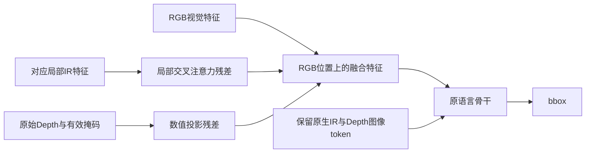

# 标注修正后的结构性改进计划

2026-10-25更新：第一轮辅助监督方案已形成真实数据、固定A/B训练入口及评估清单，见[首轮实现说明](../2026-10-25-grounding-aux-round1/README.md)。下文保留原方案依据。

2026-10-24。依据[本次91条修订](../../../../docs/research/2026-10-24-label-fix/README.md)、[历史探索](../2026-10-23-reassessment/history.md)、[此前论文与源码审读](../2026-10-23-reassessment/literature.md)，并补读RGBX-R1、GroundingME和GETok的方法及关键对照。这里给出下一轮推荐方案；尚未运行新模型推理或训练。

**推荐主线：保留27B原生三图、单次直接出框，先把监督从“只给一个正确框”扩展为“辨别完整目标、竞争对象和可用模态证据”。第二轮根据实际瓶颈，在短框强化学习与视觉对齐层改动之间选择一条。**

首轮改变的是训练目标与监督结构；真正的新视觉连接器属于后续有条件的架构方案。这样既针对本次发现，也能区分新增能力是否来自数据、监督目标或网络结构。

## 1. 修订后的证据改变了哪些判断

本轮共对52条应用修改：51条完成修订，#84仅修正确定错误的描述、框仍待定；28条保留，11条暂缓。原命中321条按用户要求不作人工复核，原记录不变。27条描述改变，不能拿旧回答评价新问题。

在“描述未变且状态已审定可用”的53条旧错例上，Arm2二倍旧预测有19条在新参考框下达到IoU≥0.5，另34条仍未命中。这19条体现参考标注影响，不能当作模型进步或推出完整新版准确率。#26的跨人归因撤回；#20可见头肩也不能直接判成截断身体。

| 可观察的问题 | 更可信的具体证据 | 对改进方向的影响 |
|---|---|---|
| 对象完整范围与部件归属 | #2/3/68/69双灯头，#27船两段，#44–48狮子遮挡身体与尾巴，#72桶盖，#88旁人腿部 | 教模型判断哪些可见部分属于同一对象；统一扩框会同时造成伤害 |
| 同类对象与组合约束 | #25左右人物，#52/53车排序数，#65–67桥上人/灯，#81/82参照关系，#87/89犀牛/椅堆 | 需要明确候选集合、参照对象和决定性条件，不能只学类别或显著物体 |
| 辅助模态证据可用性 | 原91条中32条两框内深度全零；#82非零来自前景杆，#91水面不等于鸟体距离 | 有效深度必须先绑定主体；红外/深度没有证据时不能制造解释 |
| 本地监督语义失配 | 原Query与当前Query发生实体/序数变化，但框与当前描述不符 | 新训练样本要联合核对描述、目标身份和范围，不能把旧“困难样本”直接提高权重 |

五份既有预测在上述53条中的真值择优覆盖为30条，Arm2二倍为19条，因此只在这五份结果间挑选最多再补11条，仍有23条全部未命中。Arm2两个尺度覆盖26条。它们是候选覆盖上限；由于样本专门按Arm2二倍失败筛选，不能据此比较模型整体优劣。

**这使现有预测集成适合做有限补充，无法独自解决剩余问题。** 新候选生成可能突破这一集合上限，但需另有实测，不能把旧8B的候选互补数字搬到当前27B。

## 2. 历史探索中应保留的经验

- **原生大模型直接框保留为主干。** 27B、微调和分辨率在各自既有配置间有实际收益。最高分Arm2已经用了6928条能力混合SFT，因此“再多训一些困难Query”不是足够明确的新机制。
- **辅助模态仍有学习缺口值得研究。** Arm2存在3854行训练深度表示错误；Arm4/5同时改了深度、数据配比、排除项和视觉侧，无法单独裁定哪项有效。未来新臂统一采用正确输入表示，再比较结构和目标。
- **候选选择、定位、局部细化是不同能力。** 旧8B候选覆盖339、直接框292、选择273、细化221；正确候选存在并不保证选得对。裁剪坐标混淆和上下文丢失也是实在的失败，不因改名为“反思”或“验证”而消失。
- **8B的三图无净增益不能外推27B。** 当前模型仍缺少同输入和相同预算下的模态干预证据。本次失败集的红外/深度表现也不能代表所有查询。

本轮不恢复已明确退役的EGM、Locate或旧全量多轮Agent。当前91条保持诊断用途，不把修好的答案回灌训练后再用相同91条宣称能力提升。

## 3. 首轮主线：完整对象与条件判别的辅助监督

### 3.1 新增的学习问题

原任务是`RGB + IR + Depth + Query → bbox`。新增少量训练任务，在相同场景和描述下提供两个已核实候选，要求辨别哪个指向正确且完整的可见对象，并给一个短原因标签。

```text
主任务：三图 + Query → bbox_2d
辅助任务：三图 + Query + 候选A/B → A/B/both/neither/unknown + 一个短原因

短原因可来自：错对象、漏可见部件、违反明确条件、信息不足。
```

这是对“相似错误答案”的显式监督，不是把独立Query排在一起，也不是新增一个推理时裁判。部署时首先仍使用原生无候选提示，只生成一个框。

辅助任务必须明确问的是身份、完整可见范围或某个关系。**IoU≥0.5不能代替这些语义标签。** 部分框可能已过评分阈值，但仍漏一侧灯头；矩形内包含他人像素也可能只是遮挡与轴对齐的必然，#26正是反例。不能靠随机缩框、面积大小或是否含旁人自动生产负例。

| 训练样本 | 正确与竞争答案如何得到 | 希望改变的预测决定 |
|---|---|---|
| 完整对象 | 可靠实例/部件/分割标注或回图核实，构造完整对象与真正漏部件的候选 | 从局部显著特征扩展到同一实体的全部可见部分 |
| 相似邻居 | 同图两个真实实例，分别有唯一且可靠的描述 | Query变化时目标随之改变，减少固定选择显著对象 |
| 关系与序数 | 已明确参照对象和完整候选集合，构造只违反一个条件的竞争实例 | 同时满足属性、左右、邻接及序数，不跳过限定词 |
| 模态证据 | 主体区域中的红外可见性、有效深度或可信关系；不足时明确未知 | 用真实互补信息改变选择，避免照搬背景、无效值或泛泛模态常识 |

起始以完整对象、错邻居两类为主。关系和模态样本只有在现有资料能够可靠支持时加入，不为了凑齐四类而自动编造标签。候选顺序随机，保留两个都合格、两个都不合格及证据不足的情况；`neither`表示两者都不合格，`unknown`表示证据不足，不能合并。同时包含“大框较好”和“小框较好”，避免学成面积选择器。

### 3.2 三模态不是三个都要同等使用

对同一目标，RGB主要提供外观、部件与二维位置；红外能否补主体可见性，取决于该图中的目标信号；深度只有绑定到有效主体区域后，才可能提供相对相机的近远层次。这是需要训练和比较的角色分工，不是固定规则替模型选答案。

可用的专项辅助题应很短、能核对：

- 给定对象区域A/B，哪个区域的红外轮廓对应Query目标？若两者都看不清，答案为未知。
- 给定两个已绑定主体区域，哪个更靠近相机？只有主体深度可靠时才标近远，不能用整框中位数直接生成答案。
- 目标的一部分被遮挡后，另一侧可见部分是否仍属同一实体？不能把遮挡物自身当作目标的一部分。

`near another object`（靠近另一物体）并不等于两者到相机深度接近；没有相机几何与完整对象信息时，不构造所谓精确物间距离。也不把所有前后关系改成图像上下关系。只有在本轮修订中原描述确实多解时，才用客观二维限定恢复唯一目标。

针对辅助模态的效果，先做同一权重的内容移除/替换诊断；保持RGB尺寸和图像数量可比，区分信息变化与视觉token预算变化。需要进一步证明“训练时可利用模态”的潜力时，再用同训练预算的模态配置比较。单次遮黑下降可能包含分布变化，零下降也不证明永远学不会。

### 3.3 最小训练与实现

保留现有语言LoRA、冻结视觉塔与对齐层。直接框与辅助任务可先以约3:1作为工程起点；不把这个比例当最优结论。按样本/任务归一化监督权重，避免短标签在全局token平均中几乎失去权重。

首轮只比较两个训练臂：

| 训练臂 | 固定项 | 变化项 |
|---|---|---|
| A：普通框SFT | 同一27B参数起点、同图组、同原始Query池、同分辨率与呈现次数 | 所有训练槽位都做直接框 |
| B：直接框＋判别辅助 | 与A相同，保留共同的直接框基础曝光 | 将部分重复直接框槽位替换为经过核实的判别题 |

两臂总图像呈现和优化步数相同，记录实际输出token与GPU时间差异；相同步数不是严格相同算力。不要同时换基座、提高分辨率、解冻视觉、改奖励或增加长解释。

若从现有Arm2适配器权重开始，作为共同参数初始化并新建优化器；归档的适配器不等于完整断点状态。两臂必须采用同一加载方式，不把一臂从基座、一臂从旧微调权重作为目标对照。

可复用的入口：

- [prepare_qwen3vl_native_sft.py](../../../tools/prepare_qwen3vl_native_sft.py)：模态顺序、深度表示和0–1000框编码。
- [convert_manifest_to_swift.py](../../../tools/convert_manifest_to_swift.py)：对话及多图格式。
- [train_qwen36_27b_swift.sh](../../../scripts/train_qwen36_27b_swift.sh)：语言LoRA训练。只增加必要的辅助样本与权重处理，不另造训练器。
- [depth_relation_tasks.py](../../../tools/depth_relation_tasks.py)：已有主体区域和深度关系接口；各源单位、有效范围及主体归属仍须核对，中心小框只是低置信近似。
- [predict_submission_vllm.py](../../../tools/predict_submission_vllm.py)：第一轮部署继续一次直接框。

**决定性结果是B相对A的无候选、单次直接框ACC@0.5。** 辅助题答对更多但直接框没改善，就不能声称学到了可迁移的定位能力。此时应停下并检查给定候选是否省略了真正困难的搜索，而不是再叠一个裁判。

## 4. 第二轮：根据缺口，在RL与视觉侧之间选择

### 4.1 证据已可读、单次决策不稳：短框GRPO

如果同一输入的有限采样能产生正确完整框、模型也能辨别可靠候选，但单次输出仍常选错，优先比较短框GRPO与等预算继续SFT。保留第一阶段权重作为零追加成本参照。

奖励从可信框的IoU和ACC@0.5目标出发，首个候选为阈值奖励加小连续IoU项。连续项给未过线但有重叠的答案提供差异；全为零IoU的错误对象不应靠虚构形状或语言奖励“制造正确方向”。格式已稳定时，格式奖励不能主导结果。

不把“没有采到正确框”当作数学上永远不会产生的证明，也不把“采到过”当作RL必然有效。观察组内框身份、奖励差异以及最终单次结果。短证据后出框只有在第一阶段已证明某类可核对证据有价值时才加入对照；不默认生成长思维链。

### 4.2 主体证据可见、模型却读不出：对齐层LoRA

如果给定正确区域后，模型仍读不出清楚的红外轮廓或有效深度关系，先核对表示、配准、尺寸及监督，再做最小视觉侧对照。最易接入的参数配置是：

```text
冻结视觉塔：FREEZE_VIT=true
允许对齐层LoRA：FREEZE_ALIGNER=false
```

这是利用现有模块改变视觉到语言映射的适配范围，不是已经实现的新融合网络。与全冻结臂保持同样数据、目标及起点；不能把同时改了多项的Arm4/5当作这个对照。若模态内部表征本身仍不足，再单独考虑视觉塔LoRA，不同时放开所有参数。

当前训练入口已有上述开关；当前vLLM入口仅启用普通LoRA。视觉塔/连接器LoRA在[vLLM文档](https://docs.vllm.ai/en/stable/features/lora/)中属于实验性支持，必须核对目标模型与运行版本的实际加载路径。训练能启动不代表现有推理入口已经可部署，见[架构审查](review-architecture.md)。

**本轮选择视觉侧对照时，不自动再接第三轮RL。** 先明确它是否改变了辅助模态读取和最终框，再决定后续投入。

## 5. 真正的跨模态融合模块：保留一个具体候选

若各模态单独能识别给定区域，但对应和融合依旧失败，可以研究：**以RGB二维位置为参照的局部红外交叉注意力，加有效深度数值的独立投影残差。**



它试图让不同模态在对象所在位置交换信息，避免只依赖语言层从三段图像token中自行寻找对应。IR使用局部邻域是为了容纳小范围错位；Depth掩码用于阻断无效传感值，数值投影保留其距离含义。不能把整个矩形背景的深度当成对象监督，也不能认为局部窗口自动解决视差和遮挡。

具体实现必须处理Qwen动态分辨率、每路`image_grid_thw`、merger后的二维网格、不同模态尺寸和实际相机对应，并修改训练前向与推理加载。旧8B的Qwen3-VL/DeepStack代码不能直接搬到当前`qwen3_5`。此前DualVision源码的固定方形网格、稠密局部掩码也不能直接当作高效动态版本。

首个候选让残差与原生三图共存，零初始化时回到原生三图模型；只有在后续明确比较时，才考虑用融合特征替代IR/Depth图token。替代后若残差为零，退回的是RGB模型，二者不能混称同一基线。

该模块只有在“信息确实存在、单模态可读、小范围视觉适配仍不能解决跨模态对应”的专项证据下才值得优先开发。当前34个可重算未命中里有大量RGB即可解释的问题，尚不足以把全新连接器定成第一轮主线。

## 6. 新资料带来的取舍

### RGBX-R1：模态理解监督值得研究，但不能照搬完整流程

[RGBX-R1](https://arxiv.org/html/2602.00504v1)在模板加多帧RGBX定位中，将模态理解监督与后续RL组合。其普通SFT、仅CoT冷启动、普通SFT加RL、完整流程的平均结果为31.04、19.64、32.74、46.53。其时间加权IoU和参考推理token匹配不适合直接迁移；附录深度为近暗远亮，与本项目近亮表示相反。

对本项目的启发是教清对象与辅助信息的对应；单独加入CoT的收益没有被这组结果保证。本计划采用短、可核对的辅助任务，并专门检验向直接框的迁移。

### Perception-R1与空间模态工作：按任务选择监督

[Perception-R1](https://arxiv.org/html/2504.07954)的相关RefCOCO实验支持短输出感知策略，但不能据此否定训练期跨模态中间监督。[SpatialRGPT](https://arxiv.org/html/2406.01584v2)研究给定区域后的空间关系与深度对齐；[DualVision](https://www.amazon.science/publications/dualvision-rgb-infrared-multimodal-large-language-models-for-robust-visual-reasoning)研究配对RGB/IR与局部注意力。它们支持区域绑定、真实配对监督的方向，不能直接证明本赛端到端框收益。此前已核对的方法与源码边界见[文献审读](../2026-10-23-reassessment/literature.md)。

### GroundingME：细粒度关系确有难点，昂贵裁判仍需证明净收益

[GroundingME](https://arxiv.org/html/2512.17495)把相似实例、空间关系、小目标/遮挡等分开诊断。其Best-of-16结合大模型裁判有增益，但较小裁判只看最终答案的对照未带来同样收益；工具缩放也留下坐标问题。对本项目应借鉴机制分组与真实选择结果，不直接搬16次长推理和裁判流水线。

### GETok：几何表示是备用，不是当前首要缺口

[GETok](https://arxiv.org/html/2512.10554)用网格和偏移词元表示空间位置，涉及新增词表及相应训练。它提供了比数字字符串更显式的几何表示思路，但不能解决错误Query、错实例或没有主体深度的问题。当前不优先改坐标词表；只有剩余错误明确集中于同实例几何表达，并有更大训练预算时再考虑。

## 7. 观察尺度、多模型与新基座的定位

| 方向 | 进入条件 | 关键比较 |
|---|---|---|
| RGB高分辨率、辅助图较低分辨率 | 希望节省成本或减少无效辅助token | 先保持RGB不变只降辅助路，再独立考察把预算转给RGB；分别报告总分与有效辅助模态题退化 |
| 全图＋一次局部观察 | 存在小目标或部件确实看不清的证据 | 保留全图和参照对象，统一全图坐标；与等计算量直接采样/分辨率比较，不能用GT选裁剪区域 |
| Rex等新候选源 | 相对当前27B能新增可靠实例或完整范围覆盖 | 先量新增覆盖，再量训练后选择的净救回；不能只报真值择优上限 |
| 更强基座 | 相同输入预算下呈现可用收益或互补 | 零样本对零样本，微调对微调；与数据/目标改动分开归因 |

这些可以做小规模信息收集，但不阻塞首轮监督目标比较。已有五份输出在这53条旧失败子集中最多再补11条，当前证据不足以优先建设复杂选择系统；新模型若带来明显新覆盖，才重新安排优先级。

## 8. 执行顺序与判断标准

1. **数据与评估入口已落地。** 使用新版412条清单；27条改Query需新推理。11条暂缓和#84单独保留，不悄悄删除以提高分数。原321条可自动评估回归，但不增加人工检查。本次已审可用的79条与原321条应分别报告，不把整个新版称为人工清洗集。
2. **准备首轮可靠训练图组。** 从已有合法训练源中选完整实体、相似邻居及可核对辅助模态样本，联合检查描述与框；新增监督不从本次91条答案复制。按实际场景/序列分组，少量独立且未参与本队调参的外部图组用于确认泛化，无需等待大而完美的新数据集。
3. **只训练A/B两臂。** 先回答辅助判别能否改善原生单次框。主看ACC@0.5、配对救回/破坏、完整范围与实例错误；辅助题准确率仅作诊断。按独立场景汇总，避免同图多Query和邻近帧夸大证据。
4. **第二轮只押一个缺口。** 信息可读、选择不稳则短框GRPO；主体证据可见但读取/对齐仍失败则最小视觉侧对照。两条路线不自动串联。
5. **出现明确反证就改方向。** 只会判候选却不能直接定位；只涨平均IoU却没有更多过线、甚至破坏旧正确；局部观察持续丢参照对象——均应回到相应假设，而非继续叠规则。关掉辅助内容后收益完全保留时，不得将该收益归因于推理时读取辅助模态；训练期跨模态监督向RGB能力迁移仍是另一种待检验解释。

City412是长期开发集，修标签不恢复其独立性。修订带来的重算、同数据继续训练带来的收益、新目标带来的收益和新结构带来的收益分别报告。竞赛决策可以依据少量正向结果继续探索，但不把观察到的开发集增益写成已证明的官方提分。

补充审查：[监督目标与训练路线](review-supervision.md)、[架构可实施性](review-architecture.md)。
