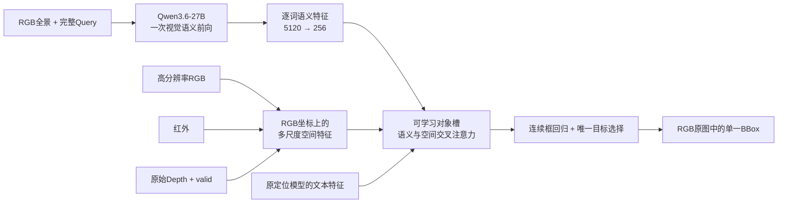

# 从三图生成坐标，转向视觉语义与空间定位联合模型

> 历史提案，默认主线及实施优先级已于2026-10-25撤回。正文保留用于对照审查，不再代表当前裁决。见[修订后的架构研究](README.md)与[GroundingDINO失败复盘](../2026-10-25-dino-retrospective/README.md)。

2026-10-25。本轮重新研究架构，不延续“少量辅助题先跑通，再决定是否改结构”的主线。前轮 A/B 改变了训练回答，却保留了视觉表示、模态融合和出框机制；它可以作为监督对照，不能承担这次结构探索的目标。

**我的主张：保留 Qwen3.6-27B 对 RGB 场景与 Query 的理解，另外建立保留空间细节的 RGB/IR/原始Depth 定位分支；两路在对象选择和定位过程中联合计算，由可学习对象槽和连续框头输出最终框。框损失直接训练语义桥、语言LoRA和三模态定位分支。**

这是一套需要实现和训练的新模型。本文没有新模型实验结果，不预报提分幅度。研究依据、公开代码缺口及独立路线裁决均在后文链接的专题文档中。

## 1. 这次究竟改变什么

| 决定预测的环节 | 现役主模型 | 本轮主方案 |
|---|---|---|
| 传感器表示 | 三图进入同一原生视觉编码器；Depth先转8位视觉图 | RGB/IR保留二维特征，Depth保留数值、有效掩码及来源单位信息 |
| 模态交互 | 三段视觉token主要在语言层交互 | IR在RGB局部邻域对应，Depth在同一空间网格进入定位特征 |
| 对象与关系 | 隐含在生成过程 | 可学习对象槽保留实例表示，联合读取完整Query语义与空间证据 |
| 最终出框 | 自回归生成坐标文字，再解析 | 每层连续修框，最终目标分数选出唯一框 |
| 优化目标 | 回答token交叉熵 | 唯一目标选择 + L1/GIoU，梯度连到两条分支 |

这些变化对应我们已观察到的错实例、完整可见范围、参照关系和辅助模态利用问题。它们不意味着现役模型“不会空间推理”，而是让这些预测决定获得更直接的表示与监督。高分辨率和新数据的贡献另列，不能全部记到架构名下。

## 2. 深读后真正改变判断的证据

本轮围绕三个结构问题选取12篇核心论文：传感器如何融合、对象如何形成与定位、模型是否需要主动取得新证据。已阅读这些工作的正文与技术附录，并核对可获得的方法相关模型、训练、数据和推理源码；关键图表另渲染复核。没有把下载、摘要或README当作完成深读，也没有声称审计各仓所有第三方框架代码。

| 研究链 | 实读工作 | 对主方案的影响 |
|---|---|---|
| 真实传感器融合 | RGBT-GroundBench/RGBT-VGNet、DualVision、RDTTrack | 最贴近任务的证据来自RGB+TIR文字定位；采用局部空间对应与模态独立表示。跟踪初始化框、伪彩Depth和自由形变不照搬。 |
| 对象与连续定位 | Groma、Grounding DINO、MDETR | 采用可学习对象表示与框损失；放弃冻结候选列表作为唯一出框空间。开放词汇检测仍需学习唯一指代。 |
| 高细节视觉连接器 | Cambrian-1、Eagle | 高细节特征可留在语言模型外供局部读取；复杂连接器没有普遍优于简单拼接，须保留同坐标融合对照。 |
| 显式关系 | SVCR | 有向对象关系值得研究，但其Depth来自RGB估计；无框弱监督与伪正例不是本赛强监督配方。首轮关系由槽间交互学习，显式pair头作为独立扩展。 |
| 主动观察与RL | DeepEyes、Pixel-Reasoner、LFPC | 主动取证是一条真正不同的竞争路线；工具调用率不能证明模型利用了图像。 |

三个源码发现尤其重要：

1. **Groma训练时会把GT框加入区域集合，感知器在该路径不接收语言损失梯度。** 这帮助语言模型学区域引用，却不能说明推理候选一定覆盖目标。我们的训练只用GT计算匹配和损失，最终框始终由可学习定位器产生。[对象专题](object-grounder.md)
2. **RGBT-VGNet的实际训练不只有框损失，RDTTrack还把Depth逐帧归一并伪彩化。** 应区分真正的传感器数值利用、区域监督和数据收益；本方案保留原始Depth，并且不把矩形框内统计冒充主体距离。[传感器专题](sensor-architecture.md)
3. **LFPC的反事实实验里，DeepEyes把真实裁剪换成噪声后成绩几乎没变。** 因此“会调用LOOK”不是结构成功证据，真实新信息必须能改变最终定位。[主动观察专题](active-rl.md)

源码可得性也有明确边界：LFPC与SVCR的官方仓库本次均未发布模型/训练实现；Grounding DINO作者仓缺少论文对应完整训练损失；Eagle公开默认训练脚本是两阶段，不能直接认作论文最佳预对齐配方。相关结论均区分论文描述、实际代码和我们的提议。

## 3. 主模型：语义与空间在出框前汇合



### 3.1 语义分支保留27B的视觉理解

Qwen读取较低细节的完整RGB和原Query，图像置于文字之前，取**整段Query token的末层hidden states（隐状态）**，投影到256维。定位槽可以逐词查询，保留名词、属性、关系和序数的上下文，不要求它先生成一段文字解释或四个坐标。

这个接口已核对实际 `qwen3_5` 源码：底层 `Qwen3_5Model.forward` 直接返回 `last_hidden_state`，不需要调用 `generate` 或计算大词表logits。现役配置是5120维语言状态、1152维视觉状态、patch16/merge2，且没有旧Qwen3-VL的DeepStack配置。训练和推理历史版本的具体接口见[Qwen接入说明](qwen-interface.md)。

首版保持Qwen原生RGB输入和内部结构；IR/Depth由空间分支提供。较低细节全景仍须看清对象集合，不能缩到失去场景身份。语言LoRA在线训练，不能一边声称端到端，一边长期缓存冻结hidden。

### 3.2 空间分支保住边界和真实传感器信息

以公开Grounding DINO Swin-T定位预训练作空间初始化，先保留其256维、4尺度、6层decoder、900个query配置。保留原BERT文字路径以承接已有图文预训练，在decoder内新增窄的Qwen语义交叉注意力残差。两个文本来源各司其职：原路径维持定位初始化，Qwen提供结合当前场景的高层语义；去Qwen桥的重训对照决定后者是否值得保留。

RGB、IR、Depth先做一致几何变换，并保留逆变换。RGB/IR支路使用同源视觉初始化，允许模态专有参数；IR在RGB对应位置的固定小邻域内做可学习注意力。首版不加任意光流或自由形变。Depth使用轻量数值编码器，包含有效掩码；有效值加权缩放，避免缺失零值被插成近物体。

City原始深度有明确毫米定义，可以使用固定物理尺度的单调数值通道。RGBDT500/RoboRefIt未建立统一物理单位的来源只使用相对数值和单位未知标记。缺少某个传感器与该传感器某个像素无效分开表示。缺模态样本仍可训练现有分支，不补假红外或假深度。

空间特征保留为 `F_s∈B×h_s×w_s×256`。第一版以原生高分辨率图作为空间输入起点，实际处理尺寸与现役放大设置一并记录；不把224²公开论文设置直接拿来和高分辨率27B作架构结论。具体分辨率取舍按云端资源处理，不以本机8GB限制设计。

### 3.3 对象槽完成“哪个物体”和“框到哪里”

每个槽在decoder各层同时更新对象状态和连续框，读取多尺度三模态特征、原文字特征与Qwen语义特征；槽间自注意力提供同类竞争、集合和参照关系上下文。最终目标分数选择一个槽，其连续框逆映射回RGB原图。

900个query由图文特征选出的动态锚框与可学习的query内容组成，不是冻结检测结果文件。初始锚框经过离散top-k并detach，框损失不直接穿过这一步；梯度仍经decoder对空间特征的交叉注意力更新空间分支。框可逐层移动和改变范围，因此避免固定proposal选择器的硬边界；有限槽数和空间分辨率仍可能漏目标，需查看各层预测框覆盖情况。

**首版不把显式参照物配对头列为必要组件。** 当前错对象训练对表示目标与竞争实例，不自动等价于句中的参照物；“第三个人”还涉及对象集合。SVCR式有向关系表示作为第二种可检验设计，接在同一对象表示上；有真实参照标注时监督参照物，没有时只作为潜变量，不伪造参照框真值。

### 3.4 损失直接训练两条分支

单目标样本按预测框与GT匹配，首轮目标可写为：

```text
L = 5·L1(目标预测框, GT)
  + 2·(1 − GIoU(目标预测框, GT))
  + CE(目标槽分数, 匹配槽)
```

这些系数只是实现起点。中间decoder层可使用辅助框损失；有完整对象/短语标注的公开样本继续使用对应定位与词对齐监督。

目标槽CE表示“这条Query选哪个槽”，不把其它真实物体统统标为背景。GT用于匹配，不注入推理候选；`argmax`只在推理选择最终框，训练框损失直接作用于连续预测。矩形框派生mask也不能作为真实物体轮廓或真实主体深度。

两条梯度路径必须同时存在：

```text
目标/框损失 → decoder → 三模态融合与空间分支
目标/框损失 → decoder → 语义桥 → Qwen语言LoRA
```

这正是前轮辅助回答训练没有改变的环节。详细独立裁决见[架构裁决](architecture-verdict.md)。

## 4. 训练按完整模型组织

**新结构与等数据直接框对照统一从公开基座初始化，现役Arm2保留为历史强基线。** 主模型使用Qwen3.6-27B公开基座加定位预训练；不把数百条新辅助题当作从零训练视觉系统的数据量。

当前已审核的226对辅助题来自157张不同图，其中完整三模态训练图仅79个RGBDT序列。它们适合局部域适配和同类实例监督。历史Arm2的6928行是旧混合清单计数，不能直接视为新的合法、独立训练规模。真正的训练池由以下来源重组：

- 公开RGB指代/短语定位数据负责语义桥与对象定位，包括可获取的RefCOCO/+/g及相应合法训练标注。
- RGBT-GroundBench的真实RGB+IR指代训练集负责红外对应和文字定位；本项目已有相关来源的子集，但全量覆盖仍须以实际清单为准。
- 项目中已排除保留评价图及已知官方测试重叠的City训练数据、可靠RGBDT指代数据负责真实三模态适配；RoboRefIt提供真实RGB+Depth。
- 缺模态样本只计算有依据的监督。RGBDT原始跟踪框、同图不同帧和重复采样，不自动变成新的指代标签或独立场景。

训练分两个优化阶段，目标始终是完整主模型：

1. **接通语义与空间接口。** 用公开RGB/RGBT定位数据预热桥、decoder与新模态分支，暂时冻结Qwen主分支；保留定位预训练的对象能力。
2. **联合三模态定位训练。** 开放语言LoRA、语义桥、decoder、融合与模态分支，在同一合法混合池上共同训练；保持一部分公开定位样本，避免小数据把非目标对象表示抹掉。

不再把“先证明几十条辅助题有效”设为实现新结构的前置条件，也不预设沿用旧240步预算。具体样本数与训练步数由清理后的真实训练池确定。新模型需要专门的PyTorch/HF前向和训练入口；现有普通vLLM LoRA生成请求不会自动支持这个定位decoder。

## 5. 第一轮就比较完整方案

优先启动完整模型C，同时组织下面的必要对照；不先排列十几个小模块开关。

| 臂 | 训练后的实际预测器 | 主要回答 |
|---|---|---|
| A | 等训练数据的27B三图直接框 | 新收益是否仅来自更多/更好的数据 |
| B | Qwen语义桥 + RGB空间定位器 | 改用对象槽与连续定位是否有价值 |
| C | 完整语义桥 + RGB/IR/Depth空间定位器 | 三传感器新结构能否超过A和B |
| D | 与C相同定位器，去掉Qwen语义桥并重训 | 27B视觉语义是否值得其成本 |

B/C/D使用相同定位初始化、目标监督与训练图组；B的辅助模态缺失，D保留原BERT路径。A与B不是单组件因果对照，而是两种完整范式的实际比较。记录不同结构的参数、分辨率、训练计算与推理成本，不制造虚假的完全等算力声明。

在同一已训练C上，进一步替换IR/Depth为缺失或错配输入、将Qwen视觉条件换成仅文字或错误RGB，检查哪些预测决定随证据变化。错配造成损害只说明依赖；正确模态优于B、完整模型优于D的重训结果才支持“有益使用”。如需解释局部注意力本身的收益，再增加一次同坐标通道拼接重训对照。

主指标仍是最终唯一框的ACC@0.5，按场景/序列比较净救回与损害，同时查看错实例、范围、小目标和有效辅助模态分层。City400与历史94条保留作开发诊断；新结论来自未反复调参的场景/序列留出组，不能把旧City随机再切一次称为独立验证。

最有决策价值的三种结果很直接：

- C明显好于B，而C/D接近：主收益在传感器空间定位，部署时移除昂贵Qwen桥。
- B/C都好于A，而C/B接近：保留新的定位范式，继续定位辅助模态没有发挥作用的原因。
- 空间分支的候选覆盖很差，27B直接框反而能找中：优先改空间表示与定位预训练；显式关系头无法解决看不到目标的问题。

必要的坐标和梯度检查只负责排除实现错误；它们不作为本轮科研成果的判断标准。

## 6. 两条真正不同的竞争路线

**独立三传感器Grounder。** 直接从RGBT-VGNet或完整MDETR训练链建立Query条件三模态定位网络，语言理解、传感器交互和框回归全在专用网络内完成。它押注定位归纳偏置和更充分的训练能胜过27B高层语义。它可以与主模型并行，不必等旧辅助A/B先有效；D也提供了“是否需要27B”的直接证据。[传感器方案](sensor-architecture.md)、[对象方案](object-grounder.md)

**一次双区域主动观察。** 保留生成式模型，但把是否继续观察、看目标还是竞争/参照区域变成可学习动作；从原图同步取三模态局部证据，最后仍输出全局RGB框。先用短轨迹监督，再按最终框奖励训练动作策略；真实裁剪与噪声/错位置裁剪的对照是机制核心。它押注“新证据取得方式”是主要瓶颈，与主方案的“表示与出框方式”不同。第一轮不把动作RL再塞进主模型。[主动观察方案](active-rl.md)

两种不同结构也给多模型组合提供了更有意义的来源。后续若生成式27B与空间定位器的错误互补，可以在训练集交叉预测上训练选择器，选择实例后再处理边界；两个模型选了不同物体时不平均坐标。当前没有新模型输出，因此没有实际互补率、选择器成绩或可承诺的集成增益。

## 7. 文档与执行落点

主方案下一步应新增联合模型、真实数值Depth数据路径、框损失训练入口与直接框推理入口，保留现役生成式基线。先完整接通C，再用A/B/D判断收益来源。前轮辅助标注可转为真实目标/竞争实例监督，不再主导架构节奏。

专题文档保留各研究者的独立建议；**实施优先级和主线以本文的综合裁决为准**：

- [传感器融合：RGBT-VGNet、DualVision、RDTTrack](sensor-architecture.md)
- [对象与连续定位：Groma、Grounding DINO、MDETR](object-grounder.md)
- [Eagle：多编码器与预对齐](eagle.md)
- [Cambrian-1：空间视觉聚合器](cambrian.md)
- [SVCR：有向对象关系](svcr.md)
- [DeepEyes、Pixel-Reasoner、LFPC：主动观察](active-rl.md)
- [独立架构裁决](architecture-verdict.md)
- [Qwen实际接口与梯度接入](qwen-interface.md)

本轮新增研究文档并更新HANDOFF，没有实施上述新模型。论文里的成绩属于作者数据集；本项目的判断要由完整模型的最终框结果决定。

