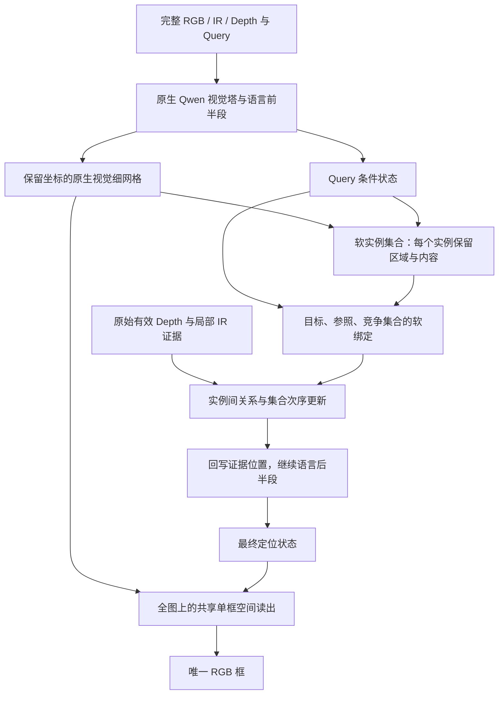

# 结构性改进裁决：让实例关系参与第一次定位

**2026-10-26 状态更新：按用户要求，本方案保留为下阶段候选。补数据、量化、Agent 与强化学习按[四问研究](../2026-10-26-four-questions/README.md)另行比较，不以本结构先取得增益为前提。下文保留 10 月 25 日设计及当时裁决。**

2026-10-25。此次重新联网研究从 23:02（UTC+8）开始，持续超过二十分钟后才收敛主线；同时回溯 2B、8B、27B 的代码、实验和数据状态。正文区分已有证据、项目推断与待验证设计。本轮完成研究和设计，未实现新模型、未训练、没有新增成绩。

**选择的主线：在现役 Qwen 的原生三图视觉表示中，建立有视觉内容和位置监督的软实例区域记忆；让 Query 的目标、参照与竞争集合绑定这些实例，计算关系后回注语言主体，再预测唯一框。** 保留一个机制不同的备选：只在训练中增加整框辅助目标，推理继续原生自回归。此前将 DINO 联合定位升为默认主线的判断撤回，不再以更换模块名称恢复该方案。

## 1. 这次必须先修正什么

上一轮的问题不只是漏看一次负结果：先选了熟悉结构，再把“可训练”“能反传”“连续框”当成改善依据，没有证明它改变了哪一次错误决定，也没有充分核对项目是否已经做过。

本轮最关键的历史发现是：10 月的 `tools/grounding_structure.py` **已经有三角色、区域绑定、同图竞争损失、原始 Depth、视觉残差和连续几何头**。其 Query 条件采用 `context.detach()`，给定已有 A 框后进行二次修正；几何头也 detach 上下文及视觉特征。R/S/S+G 在当时 City 上为 296/298/296，加入 G 没有改善。因而“加角色槽＋Depth＋连续框”不是新方案，“由二次变首次”也不足以单独成为创新理由。[历史及源码证据](history-and-current.md)

新的因果假设必须更窄、更清楚：**把多个易混实例保留下来，让有内容依据的关系更新参与首次目标绑定，并让最终框损失训练这次绑定，能否超出相同数据的普通续训？** 这是尚未被当前项目测过的完整机制，仍不等于它已被证明有效。

## 2. 全部历史对新方案的约束

| 已经发生的事 | 新方案必须回答的问题 |
|---|---|
| 2B 并行三流曾有正向记录；8B 深层融合在两个随机种子间排名反转 | 不能说融合普遍无效，也不能仅增加注入层就预测收益；需要同数据、同初始化的结构对照 |
| 8B 原生 RGB 与三图同为 288/412，三图救 11 又损 11；辅助图干预会改变答案 | “读取模态”与“真实传感内容带来净收益”不同，传感证据要绑定到具体实例 |
| EGM、Locate 专家退役；DINO 候选覆盖高，最终选择、局部改框和工具 Agent 未转成稳定净增 | 不以候选覆盖、真值择优或裁判解释替代唯一框成绩；答案范围不能被外部候选框封死 |
| GU/T/M、R/S/G 的辅助任务与几何模块曾有负结果 | 区域状态本身预测正确还不够，最终决策必须消费它；不能只增加辅助损失然后宣称结构改善 |
| 27B Arm2 二倍官方记录 .8012；Arm4 .7965、Arm5 原生 .7821 同时改了多项 | 冻结强基线；不从合包成绩推出视觉训练、Depth 修复或某个模块无效 |
| 人工错例中同时有错实例、范围、肢体归属、组合关系和标签/Query 问题 | 不能统一扩框，不能把 IoU 低都当错对象，也不能用整物体检测先验覆盖部件/组合 |
| 新辅助池 226 对/157 图，City 新主集 400 已被反复查看 | 专项池不能承担全部结构学习；City 是开发集，另建按场景/序列隔离的独立比较 |

完整路线、同口径数字、来源和现役配置见[历史与现状](history-and-current.md)。赛题事实仍以[官方材料](../../../../contest/基于大模型的多模态视觉理解与推理.pdf)为准：RGB、红外、Depth 与英文 Query，输出 RGB 坐标系归一化单框，以 ACC@0.5 优化；不以分割分数、多框 F1、推理速度替代。

## 3. 新文献改变了哪些判断

本轮不是把摘要中的最高分搬过来。主论文读到方法、消融、附录和训练配置；有公开方法源码的，追踪真实训练和推理路径。无源码的明确保留缺口。

| 文献与审读 | 可用证据 | 不据此作出的推断 |
|---|---|---|
| [ReferFlow](https://arxiv.org/abs/2610.20352)，28 页 | 同时监督区域视觉内容与位置，优于无监督连续状态；其后续定位消费区域状态 | 对象 latent（潜在状态）本身不等于推理；当前只公开项目材料，不能称代码可复现；约 1.6M SFT 不是小数据结果 |
| [Motto](https://arxiv.org/abs/2607.24407)，27 页及[源码](motto-code.md) | 空间锚、视觉回读、语言状态反馈和原生视觉框解码已有直接先例 | 不是本项目原创；其 300 查询多框头、两阶段生成与本赛不同；训练器和权重缺失，演示入口还有导入路径问题 |
| [SLR](https://arxiv.org/abs/2610.09418)，21 页 | Qwen3.5 上几何与目标视觉状态联合监督改善相似实例定位；孤立几何监督反而退步 | 复杂子集纯视觉又胜联合；其循环输入 embedding 不证明本方案中层回注已适配；没有核对到公开方法仓库 |
| [GroundAnything](https://arxiv.org/abs/2609.39600)，61 页；[LocateAnything](https://arxiv.org/abs/2605.27365)及源码 | 框块辅助训练有改善原生 AR 的消融；联合空间目标值得研究 | 并行/扩散不自动提准：GroundAnything 的高汇总 F1 与严格 IoU 优势并存，0.50 阈值反低于另训 AR；权重配方也不相同 |
| PixelLM、PixelSAIL、SELF1E 等[六篇原生空间读出研究](native-grounding.md) | 原生视觉细网格可以承担可训练空间输出，不必另加检测专家 | 低分辨率/简单头并不天然有效；很多收益依赖大量区域监督；改全局注意力还可能损害其他能力 |
| Refer-it-in-RGBD、SD-VLM、SR-3D、GR3D、SpatialRGPT 的[几何研究](geometry-reasoning.md) | 深度位置编码、实体区域与关系几何有可借鉴局部机制 | 有内参三维框、预给区域空间问答、单目估计深度，都不是本赛自由三传感单框的直接证据 |
| [VGent](https://arxiv.org/abs/2512.11099)，14 页 | 训练过的语言层对齐候选解码，不等于旧冻结编号选择 | 仍依赖外部提议，不能因此恢复旧专家；多目标指标不是本赛单框指标 |

逐项推导见[区域状态与输出论文](latent-and-output-papers.md)、[并行解码源码审计](parallel-decoding-code.md)。这些文献支持部件选择与反例设计，没有任何一篇直接证明本赛三传感新结构会超过 .8012。

## 4. 主方案的完整计算图

### 4.1 原生表示与一次中层接入

现役是 `qwen3_5` 混合线性/全注意力，语言宽 5120、视觉宽 1152、patch16/merge2，DeepStack 列表为空。取三图 merge 前特征，按处理器的实际 patch 重排恢复空间位置；不能照旧 8B 四出口 hook，也不能直接 reshape 假定栅格顺序。[接口审计](../2026-10-25-architecture-rethink/qwen-interface.md)

输入顺序为三图、完整 Query、证据位置、最后定位位置。先让原语言层读完整上下文；在一处中间层边界读取 Query 状态，由小空间模块更新证据位置，再继续原语言层。初版用约中段的一处接入，位置属于待测实施选择。**原生语言注意力掩码和线性递归协议保持原样**；实例之间需要的双向交互只在小模块里实现。标准 vLLM LoRA 请求不能自动表达这种回写，需要相应的 Hugging Face 自定义前向与推理入口。

语言主体的 LoRA 与新模块联合训练，视觉塔首轮冻结；不 `detach` Query 状态，不在整个语言前向包 `no_grad`。冻结视觉权重只表示暂不更新视觉塔，不应截断语言 LoRA 与证据模块之间的梯度。

### 4.2 实例与语言角色分开，避免把几个人平均成一个人

初版以约 32 个内部实例位置作为计算容量，加不存在状态；每个实例读全图并保持自己的软区域分布 `a_j(i)`、二维范围、视觉小网格和有效传感摘要。32 是工程起点，不是实际物体数，也没有必要输出 32 个框。

Query 的实体短语由可训练软注意读取，各角色可绑定一个或多个实例。角色容量与活跃角色数分开；完整 Query 始终可被后续语言层读取，不用硬名词解析裁掉关系修饰。多实例标注用于训练时集合匹配、空槽与身份区分；只有一个目标框的样本不伪造全场景对象列表。

这是**内部可微候选表征**，应如实承认有限容量和漏实例风险。区别在于：没有外部检测器规定的类别/硬框池，最终输出仍读完整网格，可以离开任何一个实例区域。不能把“没有外部候选”写成“没有任何候选假设”。

“车旁从左数第三个人”不能通过一个“人”平均向量解决。实例区域必须保持分离；角色“人”先绑定竞争集合，车作为参照，序数再在符合条件的集合上解释。Query 的限定先后由语言条件决定，不硬编码所有“第三个”都在全图人群中数。

### 4.3 关系在出框之前改变目标分布

对实例 `j,k`，小关系模块读取视觉内容、相对二维位置/范围、角色绑定和有效 Depth 分布。消息由 Query 调节，更新实例状态与目标分布。先做实例之间的关系，避免构造全部高分辨率像素两两交互。

序数可提供一个可微次序线索：

`rank_j = 1 + Σ(k≠j) p(group,k) · sigmoid((x_j - x_k)/τ)`。

这里按实例计数，不能以亮区域面积或重复槽位代替物体个数。它只是向语言推理提供排序信息；漏实例、重复实例、错误竞争集合都会令它失败，须由多实例监督及最后定位损失共同约束。

Depth 直接使用原始数值与有效掩码；比较实例的有效深度分布及其顺序，保留不确定性。缺深度不等于远处，不把整个矩形的深度平均当主体距离，不在缺内参时造伪米制 XYZ。IR 用同位置邻域的局部读取提供可见性证据，不用类别短词重新替换完整 Query。任何模态都不能被强制设为每题有效。

关系更新后的实例/角色信息回写语言证据位置；最后定位位置在剩余层中可以消费这些信息。这一回注必须改变可测的目标绑定，而非只生成好看的中间热图。

### 4.4 最终范围仍可覆盖部件、组合及池外位置

最终定位状态、目标相关图与完整 RGB 细网格共同进入一个共享单框读出。四个边界查询在小模块中交互，使用同一目标状态和整框 L1/GIoU（广义交并比）监督，以有序区间参数化保证合法框。它不等于四维联合概率模型，也不保证永不混实例；只是把几何目标和边界间的信息交换写进训练。

不对 mask 直接求外接矩形，不把“完整物体”设为唯一输出。若 Query 指两盏灯，实例记忆提供多个部件证据，最终范围可覆盖它们；若只指车灯，读出可缩到车内。目标图是条件信息，不是将图外概率硬置零的裁剪框。

同样的中间状态还训练原生 AR 坐标出口，作为机制对照。部署前固定一个出口，不在测试时按真值择优。**若关系状态只改善 AR，则采用 AR，连续框形式不值得单独维护。**

## 5. 为什么这与旧 R/S/G 不是同一件事

| 项目 | 旧 R/S/G | 此次要检验的变化 |
|---|---|---|
| 决策输入 | 已有 A 框与二次修正上下文 | 原始三图与完整 Query，无先验预测框 |
| 实体表示 | 目标及最多两个参照角色聚合 | 角色与多实例集合分开，同一角色保留多个竞争实例 |
| 中间内容 | 主要区域绑定和竞争监督 | 区域位置＋区域视觉布局监督，保留实例内容，避免只学坐标捷径 |
| 关系计算 | 角色条件读出 | 显式实例间消息和集合次序更新，在首次目标分布中生效 |
| 梯度 | 多处 context/视觉 detach；连续头修 A | 最终框→后半 LoRA→回注→关系与绑定→前半 LoRA |
| 答案范围 | 围绕已有 A 的修正协议 | 完整网格上的单框，支持部件、组合及初始软区域之外 |

单项都不是全球首创。项目层面的创新假设是这组连接能解决历史上“身份绑定错、传感证据不属于主体、关系没有改变首次决定”的具体问题。即使实现符合表格，仍须与新增数据收益分开。

## 6. 训练数据和损失必须支撑这个结构

总损失可写作：

`L = L_final_box + λ_ar L_AR + λ_instance L_instance + λ_content L_content + λ_role L_role + λ_relation L_relation`。

这不是要求所有样本都有所有标签。有真实实例 mask 才做实例区域监督；只有框时做框/投影弱监督，不能称像素真值。区域内容用冻结原生视觉塔 GT 区域的 4×4 特征作训练目标。**GT 区域只出现在损失端，训练和推理回注的都是模型自己预测的区域内容。** 目标特征可以 stop-gradient，预测链不截断。

数据准备分三种监督能力，而非机械拼一串数据集：

1. 同图多实例与语言目标：RefCOCO/+/g 的表达和源 COCO 实例关联，训练实例区分、目标绑定与范围；有完整同类标注时才生成左右/序数对照。Visual Genome/GQA 的实体关系可补参照，不能把一个目标框臆造成全部参照框。
2. 部件与组合范围：使用有真实部件范围的来源，与整物体 Query 共同训练；不能将完整物体 mask 一律转成部件标签。
3. 真实传感内容：现有合法 RGBT、RGBDT、RoboRefIt 等负责域适配；真实 RGB-D 来源可补有效几何，但三维 amodal（完整物体）框不能直接当本赛二维可见范围。缺 IR/Depth 的公开 RGB 数据明确标缺失，不复制 RGB 伪造传感器。

当前 157 图是专项池，不是整个外部数据上限。先准备足以覆盖多实例、参照、部件的真实标注，再用专项池适配；不许把重复循环次数当独立数据量。外部标注连接与缺口另见[数据可行性](data-feasibility.md)。本轮未下载清洗这些新增数据，因此不虚构可用总量、训练时长或预期涨分。

**共同起点与历史分数分开。** Arm2 保留为冻结历史参考；已有 508 行训练引用与官方测试帧重叠记录，不能不加区分地继承后宣称新训练已排除重叠。新结构和公平对照从同一公开 Qwen3.6-27B、同一清理后合法任务混合建立共享起点，再进行等数据续训。各新训练臂使用同样的三图尺度及已修正的 Depth 渲染，不复制 Arm2 的深度高值截白问题；原始数值旁路另保留有效值。空间模块可以在冻结特征上预热，之后必须与语言 LoRA 联合；预热不设“简单头先赢”的准入门槛。

## 7. 第一轮直接测试完整机制

| 比较 | 要回答的因果问题 |
|---|---|
| 同数据、同图尺寸、同初始化、同更新量的原生 AR | 改善是否只是新增标注和继续训练 |
| 完整实例关系回注模型 | 整条新决策链是否带来最终单框净增 |
| 完整模型删关系，保留区域/内容/回注及出口 | 关系计算是否有超出区域监督的贡献 |
| 完整模型删主体回注，保留同容量空间模块 | 是否真的改变语言主体决策，还是旁路定位头独自完成任务 |
| 同一中间状态接 AR 出口 | 新空间出口是否必要；若不必要就保留有效状态机制 |

不先排 G0→G1→G2 的胜出门槛。单个线性四数头失败不能否定需要内容监督、实例关系和回注的完整模型。也不一次展开所有模态、层数、槽数的网格搜索；先回答上表的结构问题。

独立结果使用按场景/序列留出的 ACC@0.5，记录救回与损害，并分错实例、范围、部件/组合、关系/序数、有效传感条件。City400 及已查看的外部94条用于开发诊断；27 条改过 Query 的题必须重新推理，不能把旧预测拼成新版基线。

最重要的失败判据：同数据原生 AR 一样好，说明主要是数据收益；删关系一样好，说明关系模块多余；删回注一样好，说明主体反馈主张不成立；交换相似实例内容或有效深度关系而相关答案不响应，说明模型可能绕开中间证据。干预响应只证明依赖，不证明有益，最后仍以正确框净增裁决。

## 8. 唯一机制不同的备选

保持原生推理，在训练时令同一 Query 后状态额外预测整框，使用可微 L1/GIoU 或框边界对齐监督，梯度进入语言 LoRA；部署移除辅助头，仍用 AR 框。它研究的是**语言坐标 CE 缺少整框几何代价**，不建立实例关系记忆。

LocateAnything 的联合块训练改善 Slow 路提供局部依据，但本赛单框 ACC 仍待测。初版不把现役混合注意力改成扩散，不把 argmax 后计算 IoU 冒充可微损失。这是主线证据不足或成本不合适时的独立竞争机制，不能再冒充全新架构。

## 9. 当前结论与接手资料

推荐把下一次实现投入到**完整的实例关系记忆与首次决策回注**，同时保留等数据原生模型作强对照。核心不是给大模型外接更熟悉的专家，而是明确模型内部必须保留什么、关系如何改变谁被选中、最后范围损失如何训练这次选择。可行性缺口是实例/角色标注整理、细网格映射、自定义中层前向和实际训练成本；收益尚无实测。

资料索引：[历史全链](history-and-current.md) · [主论文深读](latent-and-output-papers.md) · [原生空间读出](native-grounding.md) · [Motto 源码](motto-code.md) · [几何与深度](geometry-reasoning.md) · [并行解码](parallel-decoding-code.md) · [数据可行性](data-feasibility.md) · [独立路线裁决](synthesis-verdict.md)。
