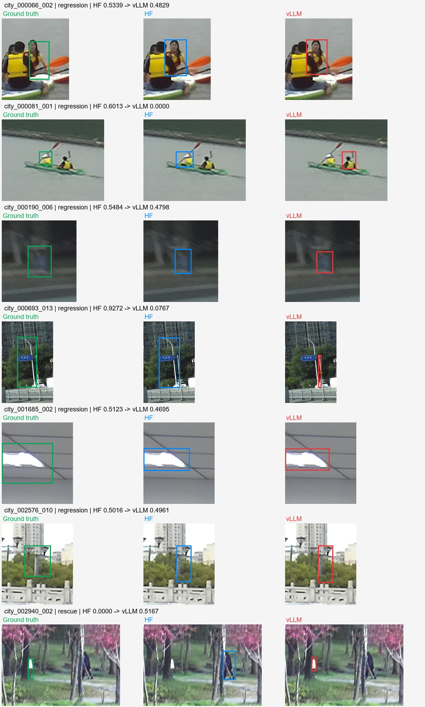

# HF与vLLM的City命中变化

纠错1600完整City378输出按题目ID配对：HF313题命中，vLLM308题命中；实际为6题退步、1题救回，净减少5题。按IoU≥0.5计命中。

| 题目ID | 查询中文释义 | HF IoU | vLLM IoU | 原图与预测框观察 |
|---|---|---:|---:|---|
| city_000066_002 | 右侧皮划艇上穿深色上衣的人 | 0.5339 | 0.4829 | 仍框同一人，原框已偏左，右边和下边进一步收缩后跨过阈值。 |
| city_000081_001 | 远处小船左侧的人 | 0.6013 | 0.0000 | 从左侧人改框右侧人，属于实例选错。 |
| city_000190_006 | 中央附近人行道上的蓝色垃圾桶 | 0.5484 | 0.4798 | 仍是同一垃圾桶，上边下移、下边上移，框进一步缩短。 |
| city_000693_013 | 支撑蓝色标牌的路灯杆 | 0.9272 | 0.0767 | HF覆盖完整弯曲灯杆；vLLM仅框右侧下半截直杆，漏掉上部弯曲段，目标范围不完整。 |
| city_001685_002 | 最左边缘的天花板灯 | 0.5123 | 0.4695 | 同一灯，两个预测框都小于标准框，vLLM进一步收紧右侧与上下边。标准框包含较多周边范围，存在框定范围敏感性。 |
| city_002576_010 | 桥最右侧的路灯 | 0.5016 | 0.4961 | 其他坐标不变，仅下边界从0.216到0.217，约原图高度的0.1%；原框已在阈值边缘。 |
| city_002940_002 | 中间穿白裤子的人 | 0.0000 | 0.5167 | vLLM救回：HF错选右侧深色人物，vLLM选回左侧标准目标，但框仍偏短。 |

6题退步中，4题是同目标框边界变化，1题选错人物，1题灯杆范围明显缩小。此为输出与图像层面的归因，不足以确定底层差异来自量化、算子或解码中的哪一项。没有据此修改标准框或重新运行模型。

逐题坐标与原查询见`city-flips.json`，原图位于`images/`。
